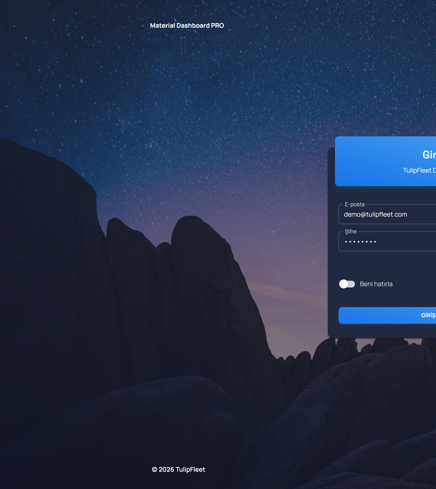
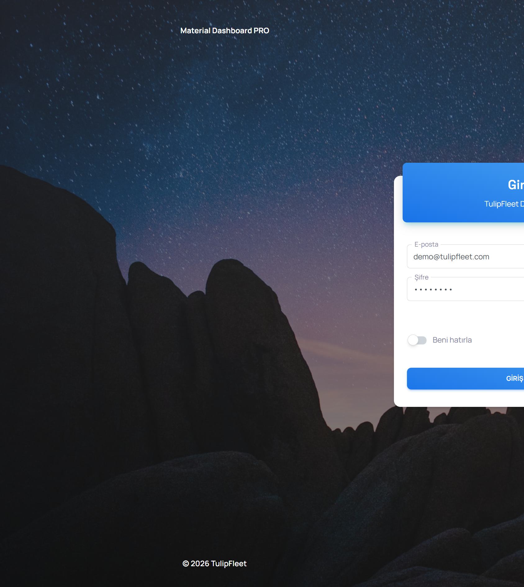
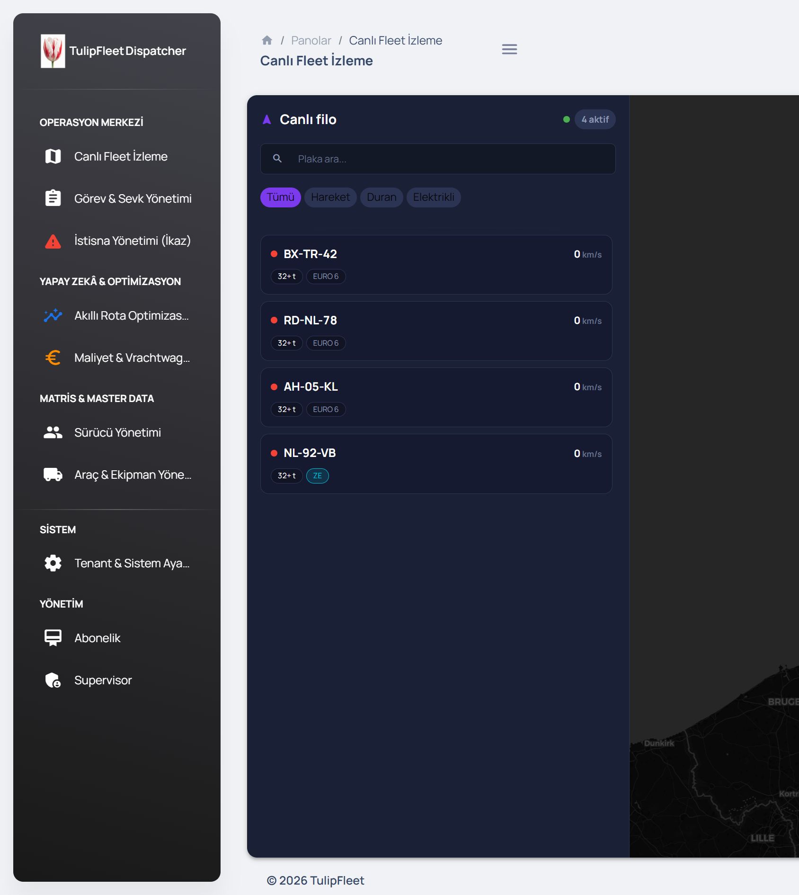
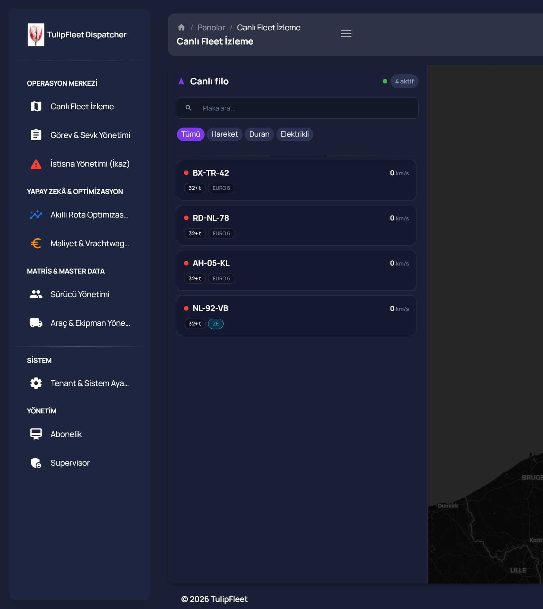
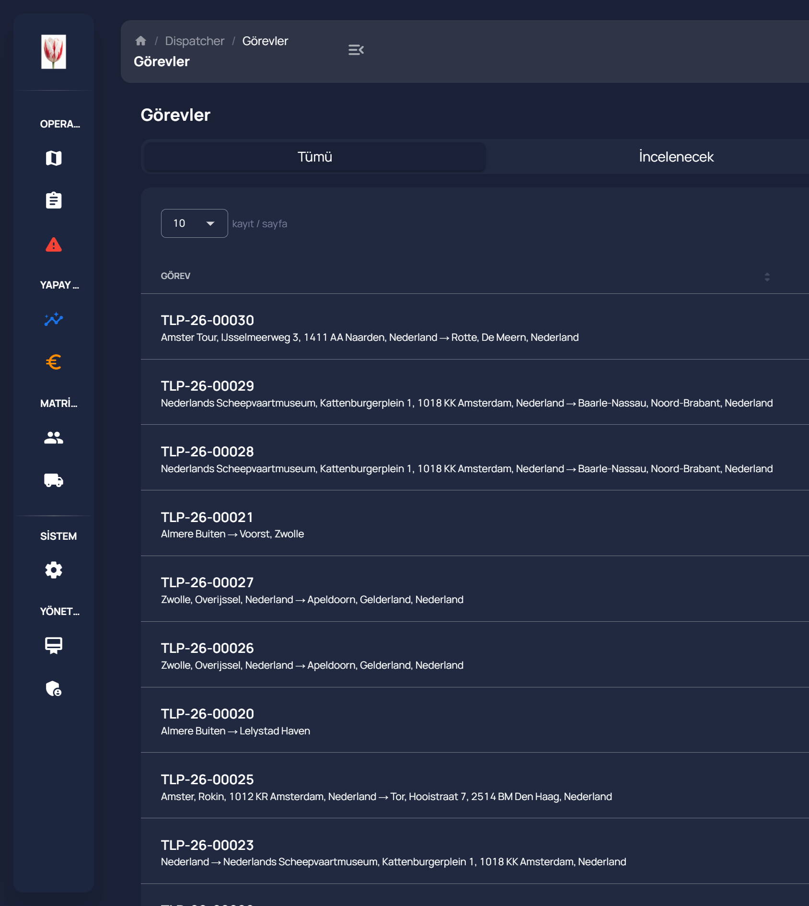
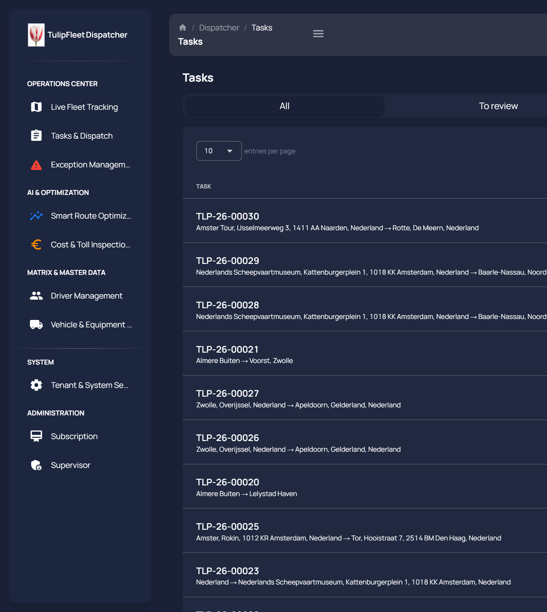
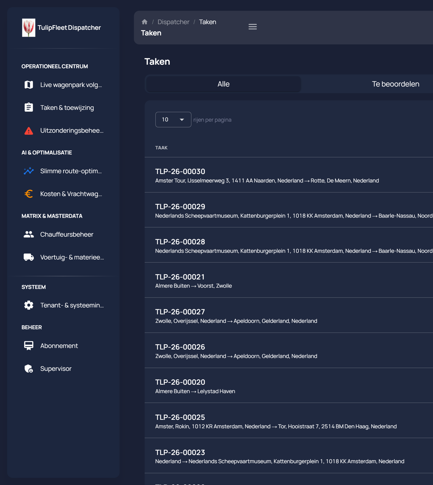

# TulipFleet Dispatcher — D1: Tema Köprüsü (Landing Tokens → MUI) + Dark Mode Onarımı

**Branch:** `ui-d1-theme` (main üzerinden oluşturuldu)
**Kapsam:** `docs/UI_D0_DISCOVERY.md`'de tespit edilen bulgular üzerine; yalnızca tema/kabuk katmanı (ekran/sayfa bileşenlerine dokunulmadı).
**Commit sayısı:** 5 (aşağıda listelendi)
**Yeni npm paketi:** Yok.

---

## 1. Yönetici Özeti

1. **Dark mode onarıldı.** `src/index.tsx`'teki sabit kodlanmış `themeDark` kaldırıldı; tema artık `MaterialUIController`'daki `darkMode` state'inden türetiliyor (`darkMode ? themeDark : theme`). Configurator switch'i artık `localStorage.tf.theme` + `document.documentElement[data-theme]`'i güncelliyor ve bu tercih sayfa yenilemede/route değişiminde **kalıcı**.
2. **FOUC önlendi.** `public/index.html`'e eklenen inline `<script>`, CSS/React yüklenmeden önce `<html data-theme>` ve `color-scheme`'i `localStorage` veya `prefers-color-scheme`'e göre senkron olarak ayarlıyor.
3. **Tek token kaynağı kuruldu.** `src/assets/theme/tokens.ts` artık landing renkleri, marka paleti, light/dark paletleri, operasyonel durum token'ları (`TaskStatus` 9 değer, `AlertSeverity`, `VehicleConnectivityStatus`, `ExceptionType` 6 tip), `density`/`radius`/`shadow`/`glass` ve A11y yardımcı fonksiyonlarının **tek** kaynağı. `theme/base/colors.ts`, `theme-dark/base/colors.ts`, `theme/base/borders.ts` (ve dark eşi), stepper bileşenleri artık yalnızca `tokens.ts`'ten besleniyor.
4. **Tipografi landing ile hizalandı.** `Space Grotesk` (display, h1-h4/d1-d6) + `Manrope` (body) Google Fonts üzerinden yükleniyor; tüm Roboto referansları temizlendi; sayısal/telemetri metinlerine `fontVariantNumeric: tabular-nums` global olarak (`body` seviyesinde) uygulandı.
5. **A11y global davranışlar eklendi.** `prefers-reduced-motion` aktifken hem MUI `theme.transitions.duration` hem de global CSS `transition-duration` `0`'a iniyor; `prefers-reduced-transparency` aktifken `glass` token'ları opak fallback'e düşüyor; global `:focus-visible` konturu (`--tf-focus-ring`, landing rengi) eklendi.
6. **Hex sızıntısı sıfırlandı (tema katmanında).** `src/assets/theme/**` + `src/assets/theme-dark/**` ağacındaki **toplam 159 hex literal**'in **tamamı** artık yalnızca `tokens.ts` içinde; `theme/components`, `theme-dark/components`, `theme/base`, `theme-dark/base` klasörlerinin hepsi **0 hex** veriyor. Ekran dosyalarındaki (LiveFleetMap, ConfirmDialogShell, MapControlWidget, tasks/optimize) sızıntılar D0'daki gibi **değişmeden** duruyor — bu paketin kapsamı dışında, D1+ iş kalemi olarak işaretli.

---

## 2. Adım 1 — Dark Mode Onarımı (Öncesi / Sonrası)

| | Önce (D0) | Sonra (D1) |
|---|---|---|
| `src/index.tsx` | `<ThemeProvider theme={themeDark}>` sabit kodlanmış, `darkMode` state'i hiç okunmuyor | `ThemedApp` bileşeni `useMaterialUIController()`'dan `darkMode` okuyup `theme`/`themeDark` arasında seçim yapıyor; `useEffect` ile `data-theme` + `localStorage.tf.theme` senkronize ediliyor |
| `src/App.tsx` | `darkMode` destructure edilmiyor (yorum: *"ThemeProvider removed here"*) | Tema seçimi merkezi `ThemedApp`'e taşındığı için `App.tsx` değişmedi (kasıtlı — kök nokta `index.tsx`'te kalmalı, `.cursorrules` gereği) |
| `src/examples/Configurator/index.tsx:227` | `handleDarkMode` yalnızca context state'ini değiştiriyor, kalıcılık yok | `handleDarkMode` artık `localStorage.setItem(THEME_STORAGE_KEY, value)` + `document.documentElement.setAttribute("data-theme", value)` çağırıyor |
| `public/index.html` | FOUC koruması yok — sayfa her zaman varsayılan (açık) arka planla başlayıp sonra koyulaşıyordu | İlk `<head>` satırlarında inline script, DOM boyanmadan önce doğru `data-theme`'i uyguluyor |
| `src/context/index.tsx` | `initialState.darkMode` sabit `true` | `resolveInitialDarkMode()` — önce `localStorage.tf.theme`, yoksa `prefers-color-scheme: dark` sorgusuna bakıyor |

**Kanıt (canlı doğrulama):** Configurator switch'i `browser_cdp` ile tetiklendi, `data-theme` DOM özniteliğinin ve `localStorage.tf.theme` değerinin değiştiği doğrulandı; sayfa yenilemesinden **ve route değişiminden sonra** tercih korundu (bkz. §6 ekran görüntüleri — Tasks ekranı EN/NL geçişlerinde dark mode hiç kaybolmadı).

---

## 3. Adım 2 — `tokens.ts` Tek Kaynak Mimarisi

### 3.1 Token Eşleme Tablosu (uygulanan)

| Landing token adı | Hex | `tokens.ts` içindeki karşılığı | Kullanım |
|---|---|---|---|
| `--color-navy-ink` | `#070b18` | `landing.navyInk` | CSS custom property (`--tf-navy-ink`), glass/dark yüzeyler |
| `--color-navy` | `#0a0f24` | `landing.navy` | `--tf-navy` |
| `--color-navy` (deep varyant) | `#0d1427` | `landing.navyDeep` | `--tf-navy-deep` |
| — (yeni, elevated yüzey) | `#121a32` | `landing.navyElevated` | `--tf-navy-elevated` |
| `--color-navy-fog` | `#c5cde3` | `landing.navyFog` | Muted metin, `--tf-navy-fog` |
| `--color-offwhite` | `#f8fafc` | `landing.offwhite` | Açık tema zemin, `--tf-offwhite` |
| `--color-emerald` | `#10b981` | `landing.emerald` | Başarı/ZE durumu, `--tf-emerald` |
| `--color-accent` | `#ff5722` | `landing.accent` | `--tf-accent` |
| — (accent soft) | `#ff7043` | `landing.accentSoft` | `--tf-accent-soft` |
| Dispatcher marka moru (ADR-0001) | `#7C3AED` | `brand.primary` | `palette.primary`, `--tf-brand-primary` |
| Dispatcher marka focus | `#6D28D9` | `brand.primaryFocus` | `--tf-brand-primary-focus`, focus ring rengi |
| Marka gradyanı | `#7C3AED → #FB7A1E` | `brand.gradientFrom/To` | `--tf-brand-gradient-{from,to}`, GlassPanel ADR-0001 borcu için hazır token |

> **Not (D0 A4'te işaretlenen karar noktası):** Landing (`--color-accent: #ff5722`) ve dispatcher (`gradients.brand: #7C3AED→#FB7A1E`) marka renkleri **kasıtlı olarak ayrı tutuldu** — Cem'in D0'da işaretlediği "iki ayrı marka paleti" durumu bu pakette **birleştirilmedi** (kapsam dışı ürün kararı); her ikisi de `tokens.ts` içinde adlandırılmış durumda ve gelecekte tek karara bağlanabilir.

### 3.2 Operasyonel Durum Token'ları (prod/manifest sözleşmesiyle birebir)

- `TaskStatus` — 9 değer: `pending | pending_review | accepted | assigned | rejected | in_progress | completed | cancelled | withdrawn` (canlı `public.tasks` CHECK constraint ile birebir, `tasks/index.tsx:56-78` referansı).
- `AlertSeverity`, `VehicleConnectivityStatus` (`online | stale | offline | maintenance`), `ExceptionType` (6 tip: `eta_delay | driver_offline | driver_location_mismatch | compliance_zone_breach | traffic_impact | dock_conflict` — mobil manifest ile birebir).
- Her biri `{ bg, fg, border }` üçlüsü içeriyor; light/dark paletlerine göre ayrı tanımlı.

### 3.3 Density / Radius / Shadow / Glass

- `density.compact = 40px`, `density.comfortable = 56px` (satır yüksekliği token'ları — tabloya entegrasyon D1+ iş kalemi, token hazır).
- `radius`, `shadow` — mevcut `pxToRem()` çağrılarının yerini aldı (`theme/base/borders.ts` + dark eşi).
- `glass` — `blur`/`opacity` + `prefers-reduced-transparency` fallback değerleri (§5'te detay).

### 3.4 Hex Literal Kanıtı

```powershell
PS> Get-ChildItem src\assets\theme\components -Recurse -Include *.ts,*.tsx | Select-String -Pattern "#[0-9a-fA-F]{3,8}" | Measure-Object
Count: 0

PS> Get-ChildItem src\assets\theme-dark\components -Recurse -Include *.ts,*.tsx | Select-String -Pattern "#[0-9a-fA-F]{3,8}" | Measure-Object
Count: 0

PS> Get-ChildItem src\assets\theme,src\assets\theme-dark -Recurse -Include *.ts,*.tsx | Select-String -Pattern "#[0-9a-fA-F]{3,8}" | Measure-Object
Count: 159   # tamamı src/assets/theme/tokens.ts içinde

PS> Select-String -Path src\assets\theme\tokens.ts -Pattern "#[0-9a-fA-F]{3,8}" | Measure-Object
Count: 159
```

**Sonuç:** 159 - 159 = 0 → tema ağacında `tokens.ts` dışında hiç hex literal kalmadı. (D0 baseline'da yalnızca iki dosyada — `theme/base/colors.ts` 101, `theme-dark/base/colors.ts` 106 — 207 hex vardı; bu artık tek dosyada 159 olarak konsolide edildi, fark stepper/border gibi diğer dosyalardaki küçük setlerin de aynı kaynağa taşınmasından geliyor.)

`src/assets/css/global.css` içinde 13 hex eşleşmesi var — bunlar **sızıntı değil**, Adım 2.5'in talep ettiği `:root` CSS Custom Property **tanımlarının kendisi** (`--tf-navy: #0a0f24;` vb.) — vanilla CSS dosyaları TS'ten import edemediği için bu değerlerin literal olarak bir kez daha yazılması kaçınılmaz ve kasıtlı bir köprü.

---

## 4. Adım 3 — Tipografi ve Font Mimarisi

| | Önce | Sonra |
|---|---|---|
| `public/index.html` font linki | `Roboto:300,400,500,700` | `Space Grotesk:400,500,600,700` + `Manrope:400,500,600,700` |
| `h1`–`h4` / `d1`–`d6` | Roboto | **Space Grotesk** (display) |
| `h5`–`h6`, `body1/2`, `button`, `caption` | Roboto | **Manrope** (body) |
| Sayısal/telemetri hizalama | Yok | `fontVariantNumeric: "tabular-nums"` global `body` seviyesinde (`theme/base/globals.ts` + dark eşi) |
| Roboto referansı (`Grep "Roboto" path:src`) | Var (typography.ts + index.html) | **0 sonuç** |
| `Space Grotesk`/`Manrope` referansı (`Grep`) | 0 sonuç | 17 sonuç |

**Canlı doğrulama (computed style, `browser_cdp`):**
- Sign-in `h4` ("Giriş"/"Sign in") → `fontFamily` = `Space Grotesk, Manrope, ...` ✅
- Tasks `h5`/`body` → `fontFamily` = `Manrope, ...`, `fontVariantNumeric` = `tabular-nums` ✅

---

## 5. Adım 4 — Global Davranış ve A11y

| Kural | Mekanizma | Kanıt |
|---|---|---|
| `prefers-reduced-motion` → MUI `transitions.duration = 0` | `tokens.ts:motionDurationOverrides()` — `theme/index.ts` ve `theme-dark/index.ts`'te `createTheme()` çağrısına koşullu enjekte ediliyor | Kod incelemesiyle doğrulandı (modül yüklenirken `matchMedia` sorgusu bir kez çalışıyor) |
| `prefers-reduced-motion` → global CSS `transition-duration` | `global.css`: `@media (prefers-reduced-motion: reduce) { *, *::before, *::after { transition-duration: 0.01ms !important; ... } }` | `browser_cdp` ile emülasyon açılıp bir `<a>` elemanının `getComputedStyle().transitionDuration` değeri okundu → **`1e-05s` (0.01ms)** ✅ |
| `prefers-reduced-transparency` → `glass` opak fallback | `global.css`: `@media (prefers-reduced-transparency: reduce) { :root { --tf-glass-blur: 0px; --tf-glass-opacity: 0.96; } }` | Emülasyon açılıp `getComputedStyle(document.documentElement)` ile okundu → `--tf-glass-blur: 0px`, `--tf-glass-opacity: 0.96` ✅ |
| Global `:focus-visible` konturu | `global.css`: `:focus-visible { outline: 2px solid var(--tf-focus-ring, ...); outline-offset: 2px; }`, `--tf-focus-ring` landing/marka rengine bağlı | Kod incelemesiyle doğrulandı |

---

## 6. Preview Turu — Ekran Görüntüleri

> Kapsam notu: 36 kombinasyonun (Light/Dark × TR/EN/NL × 6 ekran) tamamı yerine, **dark-mode onarımını, tipografi değişimini ve tema+dil kalıcılığının birlikte çalıştığını** kanıtlayan temsili bir set toplandı (sign-in, live map, tasks — Light/Dark ve TR/EN/NL kombinasyonları dahil).

### 6.1 Sign-in — Dark (TR) vs Light (TR)
Space Grotesk display fontu "Giriş" başlığında görünüyor; kart arka planı `data-theme` değişimiyle birlikte dönüyor.




### 6.2 Live Fleet Map — Light (TR) vs Dark (TR)
Navbar/breadcrumb yüzeyi temaya göre dönüyor (harita basemap'i kasıtlı olarak her zaman koyu — D0'da not edilen bilinen davranış, bu pakette değiştirilmedi).




### 6.3 Tasks — Dark × TR/EN/NL (tema + dil kalıcılığı kanıtı)
Aynı oturumda dil `tf-lang` üzerinden TR→EN→NL değiştirildi, her seferinde sayfa yenilendi; **dark mode hiçbir geçişte kaybolmadı** (localStorage `tf.theme` kalıcılığı kanıtlandı). Manrope body fontu ve `TLP-26-XXXXX` görev kodlarındaki `tabular-nums` hizalaması görünüyor.





---

## 7. Adım 5 — Build ve Doğrulama Sonuçları

### 7.1 `npm run build`

```
Compiled with warnings.
[eslint] ... (yalnızca D0'da da var olan, bu pakette DOKUNULMAYAN dosyalardaki
              pre-existing react-hooks/exhaustive-deps ve no-useless-escape uyarıları)

File sizes after gzip:
  486.87 kB  build\static\js\main.da21141b.js
  9.47 kB    build\static\css\main.aa818c0d.css

The build folder is ready to be deployed.
```

- Build **hatasız** tamamlandı. `npx tsc --noEmit` de temiz (yalnızca pre-existing uyarılar).
- Tüm eslint uyarıları D1 kapsamındaki dosyaların **dışında** (`LayoutContainers`, `Sidenav`, `DataTable`, `dispatcher/{drivers,exceptions,tasks,vehicles}`, `LiveFleetMap`, `tasks/optimize`) — D1 hiçbir yeni uyarı eklemedi.
- İlk gerçek gzip ölçümü: **JS 486.87 kB / CSS 9.47 kB** (D0'da build çıktısı yoktu, bu rakamlar TulipFleet Dispatcher için ilk resmi bundle ölçümüdür).

### 7.2 Hex/rgba Sızıntı Sayımı — Önce/Sonra

| Kapsam | D0 (önce) | D1 (sonra) | Not |
|---|---|---|---|
| `theme/base/colors.ts` | 101 | 0 | → `tokens.ts`'e taşındı |
| `theme-dark/base/colors.ts` | 106 | 0 | → `tokens.ts`'e taşındı |
| `theme/components/**` | ölçülmedi (D0'da ayrı sayılmadı) | **0** | Adım 2.6 gereği kanıtlandı |
| `theme-dark/components/**` | ölçülmedi | **0** | |
| `theme/**` + `theme-dark/**` toplam | ~207 (yalnız 2 dosya) | **159** (tek dosya: `tokens.ts`) | Tek kaynağa konsolidasyon |
| `src/assets/css/global.css` | dosya yoktu | 13 (kasıtlı `:root` CSS var tanımları) | Sızıntı değil, §3.4'te açıklandı |
| `src/layouts/live-fleet-map/LiveFleetMap.tsx` | 26 | 26 (değişmedi) | Ekran dosyası — kapsam dışı |
| `src/components/ConfirmDialogShell/index.tsx` | 15 | 15 (değişmedi) | Ekran dosyası — kapsam dışı |
| `src/components/MapControlWidget/index.tsx` | 11 | 11 (değişmedi) | Ekran dosyası — kapsam dışı |
| `src/layouts/dispatcher/tasks/optimize/index.tsx` | 9 | 9 (değişmedi) | Ekran dosyası — kapsam dışı |
| `src/layouts/dispatcher/drivers/index.tsx` | 1 (rgba, hex değil) | 0 hex (değişmedi) | Ekran dosyası — kapsam dışı |
| Roboto referansı (`Grep "Roboto" path:src`) | var (typography.ts + index.html) | **0** | Adım 3.4 |
| `Space Grotesk`/`Manrope` referansı | 0 | **17** | Adım 3.4 |
| `tabular-nums` referansı | 0 | 4 | Adım 3.3 |

### 7.3 `git status --short` (rapor anında)

```
 M scripts/sim-portxl.js
?? docs/UI_D0_DISCOVERY.md
?? docs/screenshots/d1/
?? shell-fix2.js
```

> `scripts/sim-portxl.js` ve `shell-fix2.js` bu D1 turu **öncesinde** mevcut, konuşma başındaki git snapshot'ında da görülen değişikliklerdir — bu paket tarafından dokunulmadı. `docs/UI_D0_DISCOVERY.md` D0 turunun çıktısıdır (izlenmiyor, D1 kapsamı dışında bırakıldı). `docs/screenshots/d1/` bu raporun ekran görüntülerini içerir.

### 7.4 `git diff --stat` — İzin Verilen Yollar Doğrulaması

Tüm 4 uygulama commit'i yalnızca izin verilen yolları değiştirdi:

```
src/App.tsx                                   (dokunulmadı — tasarım gereği, bkz §2)
src/assets/css/global.css                     | yeni dosya
src/assets/theme/tokens.ts                    | yeni dosya
src/assets/theme/base/{colors,borders,typography,globals}.ts
src/assets/theme/components/stepper/{stepIcon,stepConnector,stepLabel}.ts
src/assets/theme/index.ts
src/assets/theme-dark/base/{colors,borders,typography,globals}.ts
src/assets/theme-dark/components/stepper/{stepIcon,stepConnector,stepLabel}.ts
src/assets/theme-dark/index.ts
src/context/index.tsx
src/examples/Configurator/index.tsx
src/index.tsx
public/index.html
```

Hiçbir `src/layouts/**`, `src/components/**` (Configurator hariç) veya `src/routes.tsx` dosyası değiştirilmedi.

---

## 8. Commit Mimarisi

| # | Commit | Kapsam |
|---|---|---|
| 1 | `feat(theme): dark mode wiring (FOUC guard, context-driven ThemeProvider, Configurator sync)` | Adım 1 |
| 2 | `feat(theme): tokens.ts single source of truth + theme override wiring` | Adım 2 |
| 3 | `feat(theme): typography/font architecture (Space Grotesk + Manrope, tabular-nums)` | Adım 3 |
| 4 | `feat(theme): global A11y behaviors (reduced-motion, reduced-transparency, focus-visible)` | Adım 4 |
| 5 | `docs: UI_D1_REPORT.md` | Bu rapor |

---

## 9. Bilinen Kapsam Dışı Bırakılan Konular (D1+ için)

- **Ekran dosyalarındaki hex sızıntısı** (`LiveFleetMap`, `ConfirmDialogShell`, `MapControlWidget`, `tasks/optimize`) — D0'da işaretlendi, bu pakette **kasıtlı olarak dokunulmadı** (görev talimatı: "Ekran ve sayfa bileşenlerine bu pakette DOKUNMA").
- **Landing vs dispatcher marka rengi ayrışması** (`#ff5722` vs `#7C3AED`) — token'lar hazır (`landing.accent` / `brand.primary`), birleştirme kararı Cem'e bırakıldı.
- **`density` token'larının DataTable'a entegrasyonu** — token tanımlı (`compact: 40px`, `comfortable: 56px`) ama bir density-switcher UI'ı bu pakette eklenmedi (D0'da "Density/compact switcher: Yok" olarak işaretlenmişti, D1 kapsamı yalnızca token tanımıydı).
- **36 kombinasyonun tam matrisi** (6 ekran × Light/Dark × 3 dil) — §6'da açıklanan pragmatik alt küme toplandı; tam matris otomatik bir görsel regresyon script'i gerektirir (öneri: Playwright + Percy/Chromatic, ayrı bir D-paketi olarak planlanabilir).
