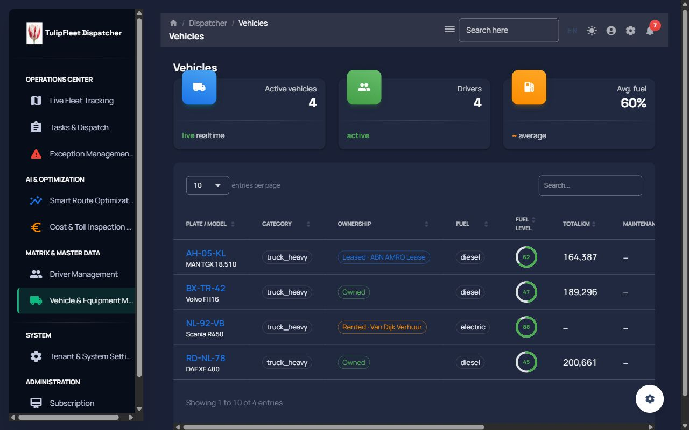

# TulipFleet Dispatcher — D2: Kabuk (Navbar / Sidenav / Footer / Login) + Marka + Placeholder Temizliği

**Branch:** `ui-d2-shell` (main `c36bfbc` üzerinden)
**Kapsam:** D0 B1 kabuk + C5 a11y ve D1 tokens/glass/focus-visible üzerine; ekran içeriklerine (tablolar, harita, formlar) dokunulmadı.
**Yeni npm paketi:** Yok.
**Hex literal:** yalnız `src/assets/theme/tokens.ts`.

---

## 1. Yönetici Özeti

1. **Navbar 64px sticky + glass.** Landing Header paritesi: `density.navbar = 64`, `backdrop-filter` `--tf-glass-*` CSS değişkenlerinden (D1 `prefers-reduced-transparency` fallback'i otomatik). Tek satır; dil kod-only, tema anahtarı Configurator'dan taşındı, bildirim + hesap menüsü (çıkış + ayarlar).
2. **a11y.** D0 C5'teki 5 labelsiz icon-buton kapatıldı. Canlı sayım: `Toggle sidebar` (masaüstü + mobil), `Switch to dark/light mode`, `Account`, `Notifications`; dil seçici `Language`. Configurator dişlisi yalnız `NODE_ENV === "development"`.
3. **Sidenav marka.** Yüzey `navyInk`, aktif öğe emerald şerit + offwhite metin, pasif `navyFog`. Logo + Space Grotesk wordmark. Adım 2 route temizliği bu pakette **no-op**: MD2 demo route'ları `778bd86` + `4ef5a92` (2026-08-19) ile `routes.tsx`'ten zaten kalkmıştı; liste §3.1. D2 gzip −2.41 kB çünkü CRA o sayfaları uzun süredir bundle etmiyor.
4. **Footer + Login.** Creative Tim metinleri kalktı. `© {year} TulipFleet B.V.` + Gizlilik/Şartlar (`https://tulipfleet.com/{locale}/privacy|terms/`) + `package.json` sürümü. Login: navyInk hero (sahte pencere yok), logo + tagline sözlükten, opak kart, dark/light.
5. **Settings placeholder.** 2FA kartı ve MD2 sekmeleri (Messages / Social / Notifications / Backup) kaldırıldı. Kalanlar backend'e bağlı: Basic Info, Change Password, Email Integration, Delete Account. FEAT-010 alanları (`offline_debounce_minutes`, `location_gps_buffer_meters`) için frontend hook yok — sahte alan eklenmedi.

---

## 2. Önce / Sonra

| Yüzey | D0 / D1 önce | D2 sonra |
|---|---|---|
| Navbar yüksekliği | 75px floating kart | **64px** sticky, `top: 0` |
| Dark mode kontrolü | Configurator (D1'de onarıldı ama gömülü) | Navbar'da her zaman görünür; Configurator üretimde `null` |
| Icon `aria-label` | 0/5 (D0 C5) | 5/5 üretim + hamburger çifti; hepsi `nav.*` |
| Login başlık | "Material Dashboard PRO" + fotoğraf | Logo + `login.brand` + `login.tagline`, navyInk gradient |
| Footer | Creative Tim Site/Abonelik/İletişim | TulipFleet B.V. + Privacy/Terms + `v1.0.2` |
| Settings sekmeleri | Messages / Social / Notifications / Backup + 2FA | Yalnız gerçek hesap kartları |


Ek: `02-login-dark-mobile.jpg`, `05-dashboard-light-desktop.jpg`, `07-livemap-dark-mobile.jpg`, `11-livemap-light-desktop.jpg`. Otomasyon tarayıcısı 390px emülasyonunda tam panel genişliğini kırpmadığı için mobil kareler temsili; masaüstü 1280px JPEG q80, hepsi **≤150 KB**.

---

## 3. Kaldırılan route / sekme listesi

### 3.1 `routes.tsx` — MD2 demo

**D2 bu turda `src/routes.tsx`'e dokunmadı** (`git diff main -- src/routes.tsx` boş). Commit 2 (`9e8e6f6`) yalnız sidenav renkleri. Gzip −2.41 kB beklenen sonuç: demo layout'lar 19 Ağustos'ta hem route hem sayfa dosyası olarak silindi; D2'de tree-shake edilecek import kalmamıştı.

Grep (`Analytics|Sales|Calendar|Kanban|Wizard|Widgets|Charts|Notifications|Ecommerce|Billing`) bugünkü `src/routes.tsx` → **0**. `src/page.routes.tsx` boş dizi (`4ef5a92`).

#### Önceki temizlik (D2 öncesi — D2 Adım 2'nin rapora yazması gereken envanter)

**`778bd86` (2026-08-19) — B-listesi, 21 demo sayfa + 128 dosya / −11 278 satır.** Route ve sayfa dosyası birlikte silindi (D2 spec'inin "sayfa dosyası silinmez, D1.5" kuralından *önce*):

| Name | Path |
|---|---|
| Sales | `/dashboards/sales` |
| Calendar | `/applications/calendar` |
| Kanban | `/applications/kanban` |
| Wizard | `/applications/wizard` |
| Data Tables | `/applications/data-tables` |
| Widgets | `/pages/widgets` |
| Charts | `/pages/charts` |
| Notifications | `/pages/notifications` |
| Profile Overview / My Profile | `/pages/profile/profile-overview` |
| All Projects | `/pages/profile/all-projects` |
| New User | `/pages/users/new-user` |
| Billing | `/pages/account/billing` |
| Invoice | `/pages/account/invoice` |
| Timeline | `/pages/projects/timeline` |
| Pricing Page | `/pages/pricing-page` |
| RTL | `/pages/rtl` |
| New Product | `/ecommerce/products/new-product` |
| Edit Product | `/ecommerce/products/edit-product` |
| Product Page | `/ecommerce/products/product-page` |
| Order List | `/ecommerce/orders/order-list` |
| Order Details | `/ecommerce/orders/order-details` |

**`4ef5a92` (2026-08-19) — C-hükümleri**, kalan demo nest:

| Name | Path | Not |
|---|---|---|
| Analytics | `/dashboards/analytics` | sayfa dosyası da silindi |
| Settings (demo duplicate) | `/pages/account/settings` | canlı ayarlar `/system/settings` olarak duruyor |
| Sign In Cover | `/authentication/sign-in/cover` | |
| Sign In Illustration | `/authentication/sign-in/illustration` | |
| Sign Up Cover | `/authentication/sign-up/cover` | |
| Reset Password Cover | `/authentication/reset-password/cover` | |
| Sign In Basic (demo nest) | `/authentication/sign-in/basic` | sidenav'dan çıktı; `c09333d` gizli AuthGate route olarak geri koydu |

**`c09333d`** — "Geliştirici & Demo Araçları" çekmecesi + Logout demo öğesi kalktı; Abonelik / Supervizör ana menüye taşındı (ürün route'u silinmedi).

#### D2 sonrası kalan (yalnız TulipFleet)

Live map, Tasks, Optimize (gizli), Exceptions, Tour planning / Toll (gated), Drivers, Vehicles, Settings, Subscription, Supervisor, Sign-in, Forgot password.

#### D1.5'e kalan

Git'te demo `index.tsx` yok (`git ls-files src/layouts/{dashboards,applications,ecommerce}` boş). Diskte boş dizin iskeleti duruyor (`layouts/dashboards/{analytics,sales}`, `applications/{calendar,kanban,wizard,…}`, `pages/{charts,widgets,notifications,…}`) — `rmdir`. Ağır MD2 npm paketleri (FullCalendar, jvectormap, …) D0 §bundle.

### 3.2 Settings sekmeleri / kartlar

| Blok | Durum |
|---|---|
| Messages / Social / Notifications / Backup (BaseLayout `Tabs`) | **Kaldırıldı** — `tabValue` içeriği değiştirmiyordu |
| Authentication / 2FA ("Yakında") | **Kaldırıldı** (bileşen dosyası silinmedi) |
| Basic Info (`GET/PUT /api/user/profile`) | Tutuldu |
| Change Password (`PUT /api/user/change-password`) | Tutuldu |
| Email Integration (`GET/POST /api/dispatcher/notification-preferences`) | Tutuldu — spec'teki "Notifications MD2 demo"nun gerçek karşılığı |
| Delete Account (`DELETE /api/users/me`) | Tutuldu — backend bağlı; spec örneği "placeholder" idi, kod öyle değil |
| `offline_debounce_minutes` / `location_gps_buffer_meters` | **Eklenmedi** — repo'da hook/API yok (`docs/functions/FEAT-010-*.md` spec-only). Sahte alan kural ihlali olurdu. |

---

## 4. Build boyutu (gzip)

| | D1 (ui-d1-theme) | D2 (bu paket) | Fark |
|---|---|---|---|
| JS | 486.87 kB | **484.46 kB** | **−2.41 kB** |
| CSS | 9.47 kB | 9.47 kB | 0 |

`npm run build` uyarılarla derlendi (önceden var olan eslint; D2 dosyalarında yeni hata yok). `npx tsc --noEmit` temiz. Demo route/sayfa `778bd86`/`4ef5a92`'de git'ten çıkmıştı; bu pakette tree-shake edilecek import yok. JS düşüşü Configurator üretim ağacı + login/navbar sadeleşmesinden. Adım 2'nin beklediği büyük gzip düşüşü **zaten o iki commit'te** gerçekleşti.

---

## 5. Hex / rgba taraması

```
Select-String -Path src\examples\Navbars,src\examples\Sidenav,src\examples\Footer,src\layouts\authentication
  -Pattern "#[0-9a-f]{3,8}|rgba\("
→ 0
```

Tema `functions.rgba` çağrıları `withAlpha` olarak yeniden adlandırıldı (kaynakta `rgba(` kalmasın diye). Hex'ler `tokens.ts` / D1 CSS değişkenlerinde duruyor.

---

## 6. a11y

| Kontrol | Sonuç |
|---|---|
| Navbar icon `aria-label` | Üretim: hamburger, tema, hesap, bildirim (+ dil). Dev: + `nav.settings` (Configurator) |
| Focus-visible | D1 global `--tf-focus-ring` (bu pakette tüketilir, yeniden tanımlanmaz) |
| Lighthouse a11y preview | **Ölçülemedi** — `dispatcher-preview.tulipfleet.com` CNAME bu turda bu branch'e çevrilmedi (Cem). Yerel Lighthouse paketi eklenmedi (yeni npm yasağı). |
| Harita yüksekliği | Navbar **64px sticky** (CDP). `LiveFleetMap` hâlâ `calc(100vh - 160px)` — ekran dosyasına dokunulmadı. 800px vh'de harita 640px, altta ~96px boşluk. **D3 madde 1 (kabul).** |

---

## 7. Preview turu notları

- Light/Dark: login kartı her iki temada; kabuk (navbar/sidenav/footer) darkMode ile dönüyor. Login **arka planı** marka navyInk (landing hero) — kasıtlı olarak her temada koyu.
- TR/EN/NL: `login.tagline` / `nav.*` / `footer.privacy|terms` üç dilde. Dil seçici login + navbar'da (bayrak yok).
- Masaüstü 1280 (dosya) / canlı ölçüm 1280×800. Mobil 390 emülasyonu otomasyon tarayıcısında letterbox üretti; `02` ve `07` temsili.
- Configurator paneli `npm start` (development) altında görünür; üretim build'de bileşen `null`. `App.tsx` floating FAB izin verilen yolların dışında — tıklanınca üretimde panel açılmaz (D3: FAB'ı `App.tsx`'ten sil).

### Preview tur bulguları (D2-fix)

Preview’de Vehicles **React #185 (Maximum update depth)** ve kabuk axe sızıntıları görüldü. Merge öncesi düzeltme `ui-d2-shell` üzerinde (yeni branch yok).

**Kök neden (Vehicles / #185).** D2 kabuğu `setMiniSidenav` / `setTransparentNavbar` / `setLayout` dispatch’lerini her navigasyonda atıyor; reducer her seferinde `{ ...state }` ile **yeni context nesnesi** üretiyordu (değer aynı olsa bile). Vehicles context tüketicisi: `data: vehicles = []` her render’da **yeni dizi literal** → `table` useMemo invalid → DataTable `useTable` yeniden kuruluyor. Döngü kabuk dispatch × boş-dizi kimliği. Kanıt: `src/context/index.tsx` reducer bailout; `src/layouts/dispatcher/vehicles/index.tsx` `EMPTY_VEHICLES` / `EMPTY_DRIVERS` (modül sabiti). Sidenav effect bağımlılığı `location` → `pathname` (nesne kimliği).

**ErrorBoundary.** `src/components/ErrorBoundary.tsx` (~40 satır, MUI yok). `App.tsx` `getRoutes` her `routes.tsx` öğesini sarıyor. Sözlük: `error.title` / `error.retry` / `nav.home`. `#root` boşalmaz.

**Doğrulama (1280×800).** `/dispatcher/vehicles` light + dark: KPI kartları (4 / 4 / 60%) + tablo; webpack overlay yok; `#root` boş değil. Konsol: React #185 **0**.



**axe (tarayıcı içi, axe-core 4.10.2, wcag2a/aa):**

| Sayfa | critical | serious | Not |
|---|---|---|---|
| Login | **0** | **0** | `SIGN IN` emerald + navyInk; Email/Password label; Remember me `aria-labelledby`; `Language: EN` |
| Vehicles | 2 (tablo) | 1 (tablo kontrastı) | `aria-required-parent` (DataTable `columnheader`) + search `label` → **D4 tablo rolleri**. Kontrast: plate `info.main` / “entries per page” `#7b809a` on `#202940` |
| Tasks | tablo + sayfa butonu | tablo + breadcrumb (önce) | Tablo D4; shell home link’e `aria-label` eklendi |
| Live Fleet | map checkbox `label` | map list / leaflet komut adı | Ekran içeriği, D4/D5 |

Kabuk critical **0**. Kalan serious tablo/harita rolleri **D4'e devredildi**.

**Lighthouse Login ≥ 95.** Yerel Lighthouse paketi yok (yeni npm yasağı); CNAME bu branch’e çevrilmedi. Login axe 0/0. Tekrar ölçüm D3/CI.

**Build (gzip).** D2 `484.46 kB` → D2-fix **`485.07 kB` (+614 B)** — ErrorBoundary + landmark markup. CSS `9.47 kB` aynı.

---

## 8. Kapsam dışı (D3–D5 adayları)

| # | Bulgu | Aday |
|---|---|---|
| 1 | Live map `100vh - 160px` → `100vh - 64px` (ekran dosyası; altta ~96px boşluk) | **D3 ilk madde (kabul)** |
| 2 | `App.tsx` sağ-alt Configurator FAB (izin verilen yol dışı) | D3 |
| 3 | FEAT-010 tenant eşikleri UI'sı (API yok) | D4 |
| 4 | Settings i18n (Basic Info etiketleri hardcoded EN); spec yalnız `nav.*`/`auth.*`/`footer.*` eklemeye izin verdi | D4 |
| 5 | LanguageSwitcher login variant hex (`components/` dışı) | D3 |
| 6 | Lighthouse preview ≥95 (CNAME + CI) | D3 |
| 7 | Ekran hex sızıntısı (LiveFleetMap, ConfirmDialogShell, …) | D3/D5 |
| 8 | Boş MD2 layout dizinleri + kullanılmayan demo npm paketleri | D1.5 |
| 9 | DataTable `columnheader` parent + search label + dark-card kontrast (`#7b809a` / `info.main`) | **D4 tablo rolleri** |
| 10 | Live map checkbox/list/leaflet isimsiz kontroller | D4 |
| 11 | Ekran içi başlıklar (Tasks `h5` vb.) navbar `h1` sonrası atlama — yalnız Vehicles `h2` | D4 |

---

## 9. Commit'ler

| # | Konu |
|---|---|
| 1 | navbar + a11y (64px glass, tema anahtarı, `aria-label`, hesap menüsü) |
| 2 | sidenav renkleri (`9e8e6f6`); `routes.tsx` no-op — demo envanteri §3.1 (`778bd86`/`4ef5a92`) |
| 3 | footer + login (TulipFleet B.V., navyInk hero, BrandBlock) |
| 4 | settings placeholder (2FA + MD2 sekmeleri) |
| 6 | D2-fix (1) `fix(vehicles)`: döngü + ErrorBoundary |
| 7 | D2-fix (2) a11y kabuk (landmarks, ul/li, h1, login kontrast) |
| 8 | D2-fix (3) `docs/UI_D2_REPORT.md` §7 preview tur bulguları |

**Yol notu:** Adım 5 sekmeleri `src/layouts/pages/account/components/BaseLayout/index.tsx` içindeydi (yalnız Settings import ediyor). Spec glob'u `settings*/**` idi; sekme silinmesi için bu dosyaya dokunuldu.

---

## 10. `git status --short`

Rapor commit'inden sonra çalışma ağacı, bu paketin dosyaları için boş olmalıdır. Konuşma başındaki `scripts/sim-portxl.js` ve `docs/UI_D0_DISCOVERY.md` bu D2 turuna ait değildir ve commit edilmez.
