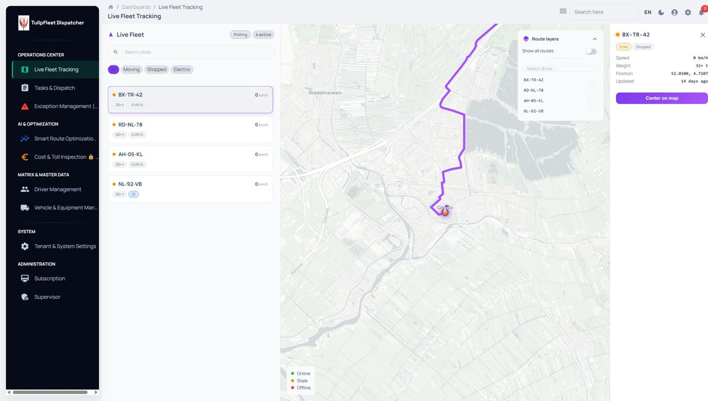
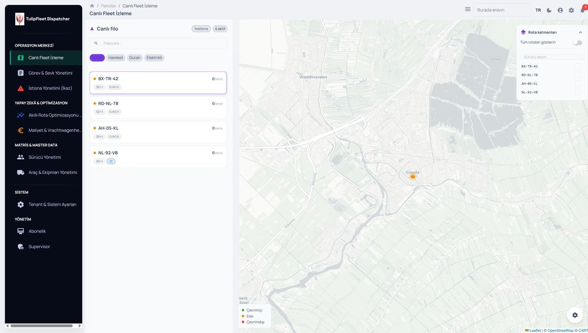
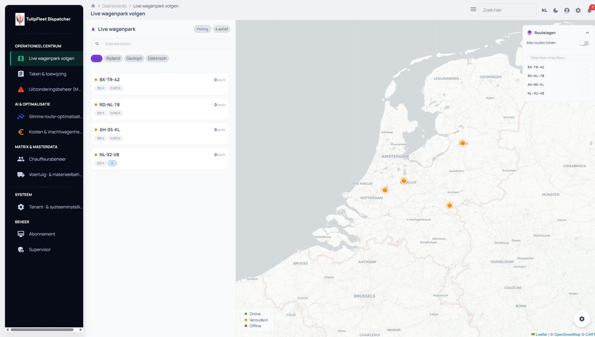
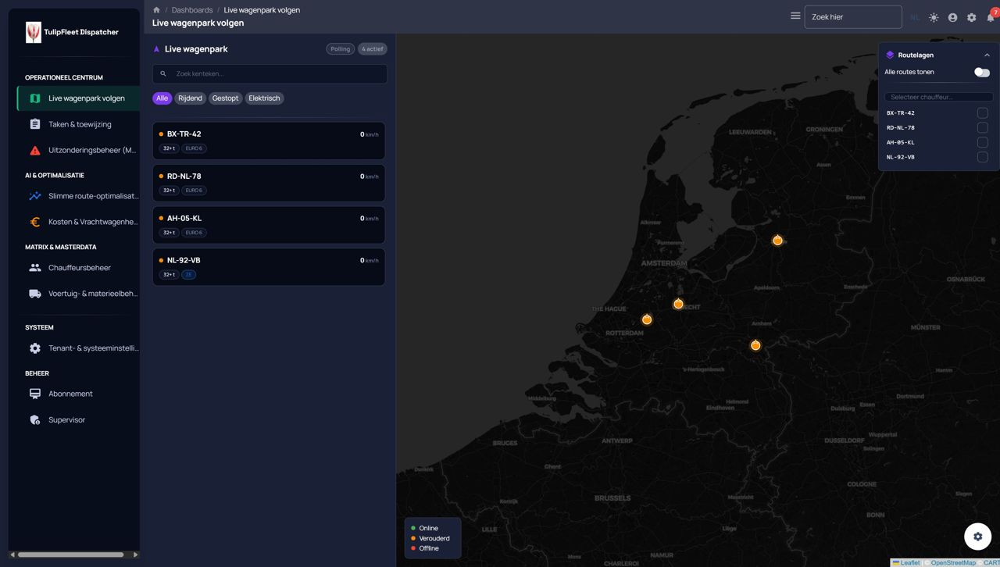
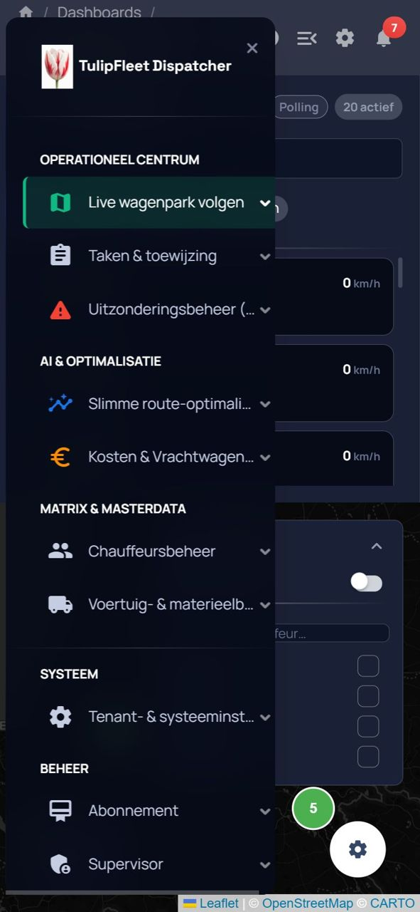

# TulipFleet Dispatcher — D3: Live Map (harita birincil yüzey)

**Branch:** `ui-d3-livemap` (main `a80d034` üzerinden)
**Kapsam:** Live map ekranı + harita bileşenleri (`LiveFleetMap`, `MapControlWidget`, araç detay paneli, marker/popup) + telemetri hook'larının UI bağlantısı. Tasks/Drivers/Vehicles/Exceptions dokunulmadı.
**Yeni npm paketi:** Yok (`react-leaflet-cluster` 2.1.0 zaten kurulu, D3'te bağlandı).
**Hex literal:** JS/TS kaynakta yalnız `src/assets/theme/tokens.ts`. Leaflet override'ları `global.css` içinde `var(--tf-*)` okur.

---

## 1. Yönetici özeti

1. **Yükseklik.** Harita kabuğu `100dvh` (navbar 64px `density.navbar`) + `100vh` fallback; Live map'te Footer yok. Leaflet `clientHeight` 1016 / `innerHeight` 1080 (= 64px navbar). D2'deki `calc(100vh - 160px)` boşluğu kapandı. `invalidateSize()` sidenav mini/geniş (300ms) ve `window.resize` üzerinde.
2. **Tema.** 37 hex `tokens.ts` `map.*` altına taşındı. Marker renkleri `status.vehicle.{online|stale|offline}`. Dark basemap CARTO `dark_all`, light `light_all` (positron); tema değişince `TileLayer.setUrl` (yeniden mount yok). Paneller opak (`navyInk` / offwhite) — cam yok.
3. **Küme / marker.** `react-leaflet-cluster` yalnız araç sayısı ≥ 20 iken; `disableClusteringAtZoom: 14`. Stale eşiği tek yer: `map.staleMs` (2 dk). Seçili araç: `fitBounds` + `paddingBottomRight = panelWidthPx` (280). Panel `Esc` ile kapanır.
4. **Bağlantı rozeti.** `live` / `polling` / `stale` / `offline` — `map.connection.*` (EN/TR/NL). MQTT env yok → rozet **Polling** (konsol `[mqtt] missing env config` kaldırıldı). Süre `formatRelative` (`src/i18n/index.ts`). Sol liste: skeleton / empty (+ Vehicles linki) / error + retry.
5. **Klavye.** `/` arama, `F` filoyu sığdır, `T` takip (`panTo`), `Esc` panel, `?` sözlükten kısayol listesi. Input odaklıyken pasif. `role="region"` `aria-label={map.region}`.

---

## 2. Önce / sonra

| Yüzey | D2 | D3 |
|---|---|---|
| Harita yüksekliği | `calc(100vh - 160px)` + Footer | `calc(100dvh - 64px)`, Footer gizli |
| Light mod | Sol panel + harita hardcoded dark (D2 §7) | Offwhite panel + CARTO `light_all` |
| Marker rengi | moving/idle/stopped (speed) | online/stale/offline (`map.staleMs`) |
| Küme | paket kurulu, kullanılmıyor | ≥ 20 araç, zoom 14'te kapanır |
| MQTT env yok | `console.error`, kırmızı 8px nokta | Rozet `polling` |
| Seçim kadrajı | `flyTo` (zoom-loop guard duruyor) | `fitBounds` + panel padding |

Masaüstü 1280px JPEG q80, hepsi **≤150 KB**. Mobil 390×844 emülasyon (D2 ile aynı sınır: otomasyon tarayıcısı tam panel genişliğini her karede kırpmayabilir).

---

## 3. Adım kanıtları

### 3.1 Yükseklik + `invalidateSize`

CDP (`innerHeight` 1080): `.leaflet-container` **1016×1166**, footer `document.querySelector('footer')` → `false`. Sidenav toggle + 300ms sonra `invalidateSize`; `resize` dinleyicisi bağlı.

### 3.2 Tema / `setUrl`

Light: `data-theme=light`, tile `.../light_all/{z}/{x}/{y}@2x.png?key=...`, liste `rgb(248, 250, 252)` (`landing.offwhite`). Dark: `dark_all`. Basemap child `useEffect` yalnızca `setUrl(url)` — TileLayer remount yok.

CARTO raster artık anahtarsız tile'lara **"API KEY REQUIRED"** damgası basıyor (D0'daki gömülü `key=` korundu). Damga altyapı/Cem (Cloudflare Preview env + geçerli CARTO key); D3 yeni key eklemedi.

### 3.3 Marker / küme / panel

- `<20` araç: düz marker (Starter 3–5 küme görmez). Kanıt: staging roster 4 araç, 0 `.tf-map-cluster`.
- `?clusterDemo=1`: **"20 actief"**, **3** `.tf-map-cluster`, 0 serbest `.tf-vehicle-icon` (şehir altı zoom). Küme ikonu `tabular-nums`, `--tf-map-cluster-bg`.
- Stale marker: GPS `last_update` > 2 dk (park hâli) → turuncu `status.vehicle.stale`.
- Detay paneli 280px sağ, opak, `role="dialog"`. `paddingBottomRight: [280, 0]`. `Esc` paneli kapatır (a11y ağacından `Close detail panel` kayboldu).

### 3.4 Rozet + veri durumları

Yerel preview MQTT env yok → badge **Polling**, `aria-label` "REST fallback · last snapshot {formatRelative}". REST 20 sn (`map.restPollMs`, hook ile aynı). İlk snapshot öncesi skeleton; HTTP hata → error + retry; 0 cihaz → `map.empty` + `/dispatcher/vehicles`.

Stale/offline geçişi: MQTT kesik = polling (kanıtlandı). REST kesilince `lastSnapshotAt` yaşlanır → `stale`; hiç timestamp yoksa `offline`. DevTools offline bu turda ayrıca koşturulmadı (Network.setBlockedURLs CDP'de kapalı); türetme `deriveFleetLink` tek yer.

### 3.5 Klavye + a11y

`?` overlay (NL): "Sneltoetsen / Focus zoeken / Wagenpark passend / Geselecteerd voertuig volgen / Paneel sluiten / Deze lijst". Region `Live wagenparkkaart` / `Canlı filo haritası` / `Live fleet map`. Search `aria-label`. Switch/checkbox `inputProps.aria-label`. Marker `title`/`alt` = plaka.

---

## 4. Doğrulama

| Kontrol | Sonuç |
|---|---|
| 2 tema × TR/EN/NL × masaüstü/mobil | Light EN/TR/NL + dark NL desktop + dark NL mobile (kareler §2). Light panel + light basemap: **D2 §7 kapandı**. |
| Küme ≥ 20 | `?clusterDemo=1` → 20 actief, 3 küme ikonu (`06-cluster-demo.jpg`) |
| Polling rozeti | MQTT env yok → Polling (konsol error yok) |
| Hex grep | `src/layouts/live-fleet-map` + `src/components/MapControlWidget` → **0** (`#[0-9a-f]{3,8}\|rgba\(`) |
| axe Live map | **critical 0**. Serious kalan: sidenav/navbar contrast (D2 kabuk), MUI List>Paper listitem (MD2). Marker `role=button` artık plaka `title`. |
| `npm run build` | **509.12 kB** gzip js (+24.05 kB vs D2 485.07 — `react-leaflet-cluster` ilk kez bağlandı). CSS 10.05 kB (+584 B). |
| `git diff --stat` | Yalnız map / tokens `map.*` / `global.css` Leaflet / i18n `map.*` / hooks UI / `docs/`. Tasks/Drivers/Vehicles/Exceptions yok. |

---

## 5. Commit'ler

| # | Tema | Dosyalar |
|---|---|---|
| 1 | Yükseklik + tema/basemap token | `tokens.ts`, `global.css` |
| 2 | i18n `map.connection.*` + `formatRelative` | `src/i18n/{en,tr,nl,index}.ts` |
| 3 | MQTT/REST UI state | `useMqttTelemetry.ts`, `useFleetSnapshot.ts` |
| 4 | Marker/cluster/panel/rozet/klavye | `LiveFleetMap.tsx`, `mapChrome.ts`, `VehicleMarkers.tsx`, `VehicleDetailPanel.tsx`, `ConnectionBadge.tsx`, `useMapKeyboard.ts`, `MapControlWidget`, `react-leaflet-cluster.d.ts` |
| 5 | Rapor | `docs/UI_D3_REPORT.md`, `docs/screenshots/d3/` |

Push: Cem.

---

## 6. Bilinçli sınırlar

- CARTO damgası mevcut gömülü key ile; Preview'da geçerli key Cem'de (Cloudflare env).
- `?clusterDemo=1` yalnız küme ekran görüntüsü; varsayılan roster gerçek snapshot.
- Zoom-loop sözleşmesi duruyor: telemetri `flyTo` tetiklemez; `T` takip yalnız `panTo`.
- Liste `list`/`listitem` MUI Paper sarmalayıcısı D4 tablolarına bırakıldı (bu turda Tasks'a dokunulmadı).
